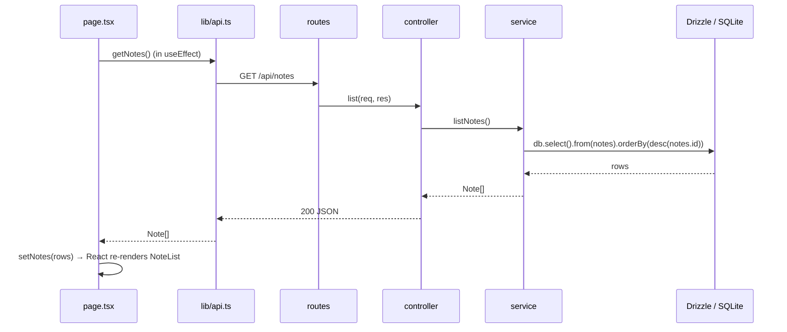

# Architecture: Program Flow and Layers

This project is a **Notes** CRUD app split into two independent programs:

| Program    | Folder      | Runs on                 | Job                                               |
| ---------- | ----------- | ----------------------- | ------------------------------------------------- |
| Frontend   | `frontend/` | `http://localhost:3000` | Next.js UI. Runs in the browser (`"use client"`). |
| Backend    | `backend/`  | `http://localhost:4000` | Node + Express REST API. Talks to the database.   |
| Database   | `backend/local.db` | (a file)         | SQLite. Accessed only through Drizzle ORM.        |

The browser never touches the database. It only sends HTTP requests to the backend.

```
┌──────────────────────── Browser ───────────────────────┐        ┌──────────────────── Node process ────────────────────┐
│                                                        │        │                                                      │
│  page.tsx  ──►  components  ──►  lib/api.ts (fetch)    │ ─HTTP─►│  routes ──► controllers ──► services ──► Drizzle db  │──► local.db
│     ▲                                   │              │  JSON  │                                          │           │   (SQLite)
│     └──────────── setState ◄────────────┘              │ ◄──────│  ◄──────────── JSON response ◄───────────┘           │
└────────────────────────────────────────────────────────┘        └──────────────────────────────────────────────────────┘
```

---

## 1. Layers

Each layer has **one job** and only talks to the layer next to it.

### Frontend (`frontend/`)

| Layer                | File(s)                                         | Responsibility                                                                                     |
| -------------------- | ----------------------------------------------- | -------------------------------------------------------------------------------------------------- |
| Root layout          | `app/layout.tsx`                                | HTML shell and global CSS. A Server Component, because it has no interactivity.                    |
| Page (container)     | `app/page.tsx` (`"use client"`)                 | Holds the app state (`notes`, `editing`, `error`) and decides what happens on each user action.     |
| UI components        | `components/NoteForm.tsx`, `NoteList.tsx`       | Render the UI and report events (`onSubmit`, `onEdit`, `onDelete`) up to the page. No API calls.     |
| API client           | `lib/api.ts`                                    | The **only** place that knows URLs and calls `fetch()`. Turns HTTP errors into JS `Error`s.        |
| Types                | `lib/types.ts`                                  | The `Note` shape shared by every frontend layer.                                                   |

**Why `"use client"`?** In the Next.js App Router, components are Server Components by default. The `"use client"` directive makes a file run in the browser, so it can use `useState`, `useEffect`, and `onClick`. All data loading in this project therefore happens in the browser through `fetch`, not on the Next.js server.

### Backend (`backend/src/`)

| Layer        | File(s)                              | Responsibility                                                                                      | Knows about HTTP? | Knows about DB? |
| ------------ | ------------------------------------ | --------------------------------------------------------------------------------------------------- | :---------------: | :-------------: |
| Entry point  | `index.ts`                           | Creates the Express app, adds middleware (CORS, JSON parsing), mounts routes, starts the server.    | yes               | no              |
| Routes       | `routes/notes.routes.ts`             | Maps `METHOD + URL` → a controller function. Nothing else.                                          | yes               | no              |
| Controllers  | `controllers/notes.controller.ts`    | Reads `req.params`/`req.body`, validates input, calls a service, chooses the status code.           | yes               | no              |
| Services     | `services/notes.service.ts`          | Business logic and queries, written with Drizzle (`db.select()`, `db.insert()`, ...).               | **no**            | yes             |
| Data         | `db/schema.ts`, `db/index.ts`        | Table definition (and the TS types inferred from it) plus the single shared `db` connection.         | no                | yes             |
| Middleware   | `middleware/errorHandler.ts`         | Catches every thrown error and turns it into a JSON response (`HttpError` → its status, else 500).   | yes               | no              |

Because services have no `req`/`res`, you can call them from a script, a test, or a different framework without changes.

---

## 2. REST API

Base URL: `http://localhost:4000/api/notes`

| Action | Method   | URL              | Body                              | Success           | Errors        |
| ------ | -------- | ---------------- | --------------------------------- | ----------------- | ------------- |
| List   | `GET`    | `/api/notes`     | none                              | `200` `Note[]`    | none          |
| Read   | `GET`    | `/api/notes/:id` | none                              | `200` `Note`      | `400`, `404`  |
| Create | `POST`   | `/api/notes`     | `{ "title": "...", "content": "..." }` | `201` `Note` | `400`         |
| Update | `PUT`    | `/api/notes/:id` | `{ "title"?: "...", "content"?: "..." }` | `200` `Note` | `400`, `404` |
| Delete | `DELETE` | `/api/notes/:id` | none                              | `204` (no body)   | `400`, `404`  |

Errors always look like `{ "error": "message" }`.

A `Note` looks like:

```json
{ "id": 1, "title": "First", "content": "hello", "createdAt": "2026-10-18 03:57:53", "updatedAt": "2026-10-18 03:57:53" }
```

---

## 3. Program flow, step by step

### 3.1 Startup

**Backend** (`npm run dev` in `backend/`):

1. `tsx watch src/index.ts` runs TypeScript directly and restarts on file changes.
2. `import "dotenv/config"` loads `backend/.env` into `process.env`.
3. Importing the routes imports controllers → services → `db/index.ts`, which opens `local.db` through Drizzle.
4. `app.listen(4000)` starts accepting requests.

**Frontend** (`npm run dev` in `frontend/`):

1. Next.js serves `app/layout.tsx` + `app/page.tsx` on port 3000.
2. The browser downloads the page's JavaScript and React runs `HomePage` on the client.
3. `useEffect` fires once and calls `api.getNotes()` → **Read flow** below.

### 3.2 Read (list notes)



### 3.3 Create

1. User types in **NoteForm** and clicks **Create**.
2. `NoteForm.handleSubmit` calls `preventDefault()` and then `onSubmit({ title, content })`.
3. `page.tsx` `handleSubmit` sees `editing === null` and calls `api.createNote(input)`.
4. `lib/api.ts` sends `POST /api/notes` with a JSON body.
5. Backend: `express.json()` parses the body → route `POST /` → `notesController.create`.
6. Controller `parseBody(body, false)` checks that `title` is a non-empty string. If it isn't, it throws `HttpError(400)`.
7. Service `createNote` runs `db.insert(notes).values(data).returning()`. SQLite fills in `id`, `createdAt`, and `updatedAt`.
8. Controller responds with `201` and the new note.
9. Frontend prepends it with `setNotes(prev => [created, ...prev])` and the form clears itself.

### 3.4 Update

1. User clicks **Edit** in **NoteList**, which calls `onEdit(note)` and so `setEditing(note)` in the page.
2. **NoteForm** receives `editing` and its `useEffect` copies the note's title and content into the inputs.
3. On submit, the page sees `editing !== null` and calls `api.updateNote(id, input)` → `PUT /api/notes/:id`.
4. Controller: `parseId` validates `:id`, and `parseBody(body, true)` validates the fields that were sent.
5. Service: `db.update(notes).set({...data, updatedAt: CURRENT_TIMESTAMP}).where(eq(notes.id, id)).returning()`.
   - If no row matched, it returns `undefined` and the controller throws `HttpError(404)`.
6. Frontend replaces that note in state with `prev.map(...)` and leaves edit mode with `setEditing(null)`.

### 3.5 Delete

1. User clicks **Delete** and confirms the browser dialog.
2. `api.deleteNote(id)` sends `DELETE /api/notes/:id`.
3. Service: `db.delete(notes).where(eq(notes.id, id)).returning({ id })`. An empty result means not found, so the controller sends `404`.
4. Controller responds `204 No Content`. `lib/api.ts` skips JSON parsing for 204.
5. Frontend removes it from state with `prev.filter(...)`.

### 3.6 Error flow

```
service/controller throws HttpError(404, "Note not found")
        │  (Express 5 forwards errors from async handlers automatically)
        ▼
middleware/errorHandler.ts  →  res.status(404).json({ error: "Note not found" })
        │
        ▼
lib/api.ts: !res.ok  →  throw new Error("Note not found")
        │
        ▼
page.tsx catch  →  setError(message)  →  red banner is shown
```

Unexpected errors (for example, a database failure) are logged on the server and returned as `500 { "error": "Internal server error" }`, so internal details never reach the browser.

---

## 4. Where Drizzle fits

| Concept                         | Where                     | What it does                                                                     |
| ------------------------------- | ------------------------- | -------------------------------------------------------------------------------- |
| `sqliteTable("notes", {...})`   | `db/schema.ts`            | Declares the table in TypeScript. It is the single source of truth.              |
| `$inferSelect` / `$inferInsert` | `db/schema.ts`            | Generates the `Note` / `NewNote` types from the table, so types never drift.      |
| `drizzle({ connection })`       | `db/index.ts`             | Creates the query builder on top of the `@libsql/client` SQLite driver.          |
| `db.select/insert/update/delete`| `services/notes.service.ts` | Type-safe SQL. Example: `eq(notes.id, id)` becomes `WHERE id = ?`.             |
| `drizzle-kit push`              | `drizzle.config.ts`       | CLI that reads `schema.ts` and creates or alters the real table in `local.db`.  |

**Changing the schema:** edit `db/schema.ts`, run `npm run db:push` in `backend/`, then update the frontend `lib/types.ts` to match.

To browse the data in a web UI, run `npm run db:studio` in `backend/`.
